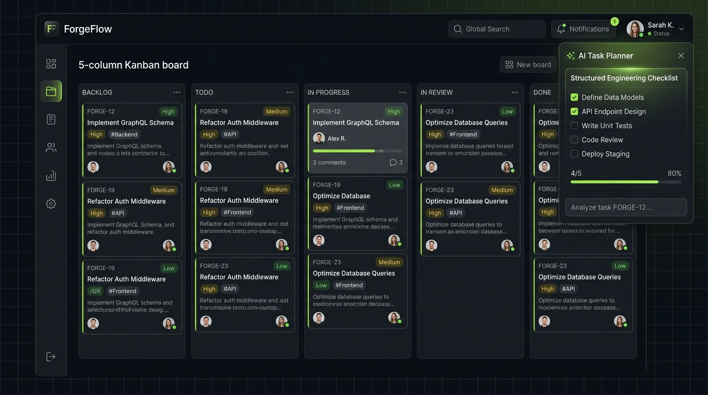

# ForgeFlow — AI-Powered Project Management Platform

> **Plan smarter. Build faster. Ship together.**

[](https://github.com/abhinavrenjithg-sys/ForgeFlow/actions)
[](https://fastapi.tiangolo.com)
[](https://react.dev)
[](https://www.typescriptlang.org)
[](https://tailwindcss.com)
[](LICENSE)

<div align="center">
  
  <p><em>ForgeFlow dark-mode workspace: 5-column interactive Kanban board, real-time telemetry, and structured AI Task Planner.</em></p>
</div>

---

## 📖 Project Overview & Concept

### What is ForgeFlow?
**ForgeFlow** is a modern, high-velocity project and issue management application engineered for forward-thinking software development teams. Inspired by the clean, keyboard-first velocity of **Linear**, the open multi-tenant architecture of **Plane**, and the audit-logged traceability of **Jira**, ForgeFlow bridges the gap between high-level product ideation and low-level engineering execution.

Unlike conventional project management tools that devolve into clunky bureaucratic databases, ForgeFlow delivers:
1. **Sub-second responsiveness** powered by optimistic UI updates and server-state caching.
2. **A signature AI Task Planner** that breaks down unstructured product briefs into actionable, structured engineering deliverables with acceptance criteria, priority weights, and subtasks.
3. **Strict multi-tenant workspace isolation** that prevents unauthorized cross-tenant data access at both the API routing and SQL query levels.
4. **An uncompromised dark-first design system** (`#0B0F17` charcoal slate surfaces with `#84CC16` lime accents) engineered for clarity during long programming sessions.

---

## 💡 The Problems ForgeFlow Solves

### 1. The "Spec-to-Ticket" Friction
* **The Problem:** Product managers write lengthy feature specifications in Google Docs or Notion, and developers dread manually decomposing them into dozens of discrete tickets with acceptance criteria, schema changes, and API requirements.
* **The ForgeFlow Solution:** The **AI Task Planner** parses raw product requirements and outputs a structured Pydantic-validated matrix of engineering tasks (database schema, API endpoints, UI components, tests, security considerations). The engineer reviews them in an interactive table with checkboxes, tweaks priorities or descriptions, and commits the approved work items directly into the project backlog in a single atomic transaction.

### 2. Sluggish, Bloated SaaS Interfaces
* **The Problem:** Established legacy tools take seconds to render board columns, clutter cards with irrelevant metadata, and require tedious page reloads for simple state changes.
* **The ForgeFlow Solution:** ForgeFlow utilizes React 19, TanStack Query, and optimistic updates. Moving an issue from *Todo* to *In Progress* updates the UI instantaneously while synchronizing via a non-blocking background PATCH request with automatic rollback if the server rejects the mutation.

### 3. Cross-Tenant Data Leakage (IDOR)
* **The Problem:** Many multi-tenant platforms blindly query resources by numerical ID (`SELECT * FROM issues WHERE id = ?`), allowing attackers in Workspace A to read or edit private issues from Workspace B simply by altering a URL or payload ID.
* **The ForgeFlow Solution:** All ForgeFlow API routes enforce tenant-scoped dependencies (`get_workspace_membership`). Every query enforces `workspace_id = context.workspace.id`. Cross-workspace mutation attempts are automatically intercepted with **HTTP 403 Forbidden** or **HTTP 404 Not Found** (verified by automated test suites).

---

## ⚡ Core Capabilities & Features

* 🎯 **Precision Dark-First UI**: Deep charcoal backgrounds (`#0B0F17`, `#141A24`), refined typography, and subtle lime accents (`#84CC16`) inspired by Linear and Plane.
* 📋 **Interactive Kanban Board**: 5-column workflow (*Backlog*, *Todo*, *In Progress*, *In Review*, *Done*) with optimistic drag-and-drop state transitions, error rollback, column quick-adds, and accessible keyboard navigation.
* 🤖 **AI Task Planner**: Convert natural language requirements into decomposed engineering tasks with title, description, priority, labels, subtasks, and acceptance criteria. Includes an editable review table and batch database commit.
* 🏢 **Multi-Tenant Workspace Isolation**: Strict tenant isolation guards at the API dependency and database layer preventing cross-workspace data leakage (IDOR).
* 👥 **Role-Based Access Control (RBAC)**: Support for `admin`, `member`, and `viewer` roles with granular permission enforcement.
* 💬 **Audit History & Activity Feed**: Immutable `ActivityEvent` logging for all status changes, reassignments, and comments with in-app notification dispatch.
* 📊 **Calculated Analytics Dashboard**: Live metrics for velocity, open vs completed counts, overdue items, completion percentages, status distributions, and team workload.
* 🔍 **Global Command Palette**: Instant `Ctrl+K` / `⌘K` modal for rapid searching across projects, issues (`FORGE-101`), and quick navigation.
* 🐳 **Production-Ready DevOps**: Docker Compose setup with PostgreSQL 16, Redis 7, Alembic database migrations, and GitHub Actions CI.

---

## 🏗️ Architecture & Technology Stack

ForgeFlow is built as a modular monolith to maximize engineering velocity and maintainability:

```
┌────────────────────────────────────────────────────────────────────────┐
│                        FORGEFLOW ARCHITECTURE                          │
│                                                                        │
│   Frontend (React 19 / TypeScript / Vite / Tailwind CSS)               │
│   ├─ TanStack Query (Optimistic UI & Cache Invalidation)               │
│   ├─ Accessible Drag-and-Drop Kanban Engine                            │
│   ├─ Command Palette (Ctrl+K) & Dynamic URL Route Sync                 │
│   └─ AI Task Planner Modal & Interactive Review Grid                   │
│                               │                                        │
│                        HTTPS / JSON REST API                           │
│                               ▼                                        │
│   Backend (FastAPI / Pydantic v2 / SQLAlchemy 2.0)                     │
│   ├─ Tenant Isolation Layer (get_workspace_membership)                 │
│   ├─ REST API v1 (Auth, Workspaces, Projects, Issues, Comments, AI)    │
│   ├─ AI Planner Service (Deterministic Engine + OpenAI/Gemini Adapter) │
│   └─ Activity Logger & In-App Notification Dispatcher                  │
│                               │                                        │
│                 SQLAlchemy ORM / Connection Pool                       │
│                               ▼                                        │
│   Database Layer (PostgreSQL 16 in Prod / SQLite Zero-Config Local)    │
│   └─ Alembic Migrations, Composite Indexes, Strict Foreign Keys        │
└────────────────────────────────────────────────────────────────────────┘
```

### Complete Tech Stack

| Layer | Technology | Rationale |
| :--- | :--- | :--- |
| **Frontend Framework** | React 19 + TypeScript | Strict type safety, modern concurrent features, rapid component composition. |
| **Build Tool** | Vite 8 | Near-instant HMR, optimized tree-shaken production bundles (`2.13s`). |
| **Styling** | Tailwind CSS + Custom Tokens | Precision dark theme (`#0B0F17`), zero runtime CSS overhead, accessible states. |
| **Server State** | TanStack Query v5 | Cache invalidation, background refetching, and instantaneous optimistic UI rollback. |
| **Backend Framework** | FastAPI (Python 3.12+) | High-throughput asynchronous routing, automatic OpenAPI 3.1 interactive docs. |
| **Data Validation** | Pydantic v2 | Strict serialization and runtime schema validation for requests, responses, and AI outputs. |
| **ORM & Database** | SQLAlchemy 2.0 + Alembic | Enterprise relational mapping, typed query expressions, and versioned migrations. |
| **Relational Storage** | PostgreSQL 16 / SQLite | Production ACID compliance in Docker; zero-config SQLite for instant local runs. |
| **AI Integration** | Modular LLM Adapter | Dual-mode: built-in deterministic decomposition engine (offline/free) or live OpenAI/Gemini. |
| **Containerization** | Docker + Docker Compose | Multi-container environment with Nginx reverse proxy, API, Postgres, and Redis. |

---

## 🚀 Quick Start Guide

### Option 1: Instant Local Development (Zero-Config)

ForgeFlow comes pre-configured with SQLite for instant local evaluation without needing to spin up databases:

```bash
# 1. Clone the repository
git clone https://github.com/abhinavrenjithg-sys/ForgeFlow.git
cd ForgeFlow

# 2. Install dependencies
npm install
pip install -r backend/requirements.txt

# 3. Initialize and seed realistic demo data
python scripts/seed_demo_data.py

# 4. Start the FastAPI backend (runs on http://localhost:8000)
python -m uvicorn backend.app.main:app --reload --port 8000

# 5. In a separate terminal, start the React frontend (runs on http://localhost:5173)
npm run dev
```

Visit **`http://localhost:5173`** in your browser.

#### Demo Credentials (1-Click Test Drive on Login Page)
* **Lead Architect (Admin)**: `alex@forgeflow.io` / `password123`
* **Senior Engineer (Member)**: `sarah@forgeflow.io` / `password123`
* **Junior Engineer (Viewer)**: `marcus@forgeflow.io` / `password123`
* **Active Workspace**: `forge-labs`

---

### Option 2: Docker Compose (PostgreSQL 16 + Redis + Nginx)

Run the entire production stack containerized with one command:

```bash
docker-compose up --build -d
```

* **Frontend**: `http://localhost:3000`
* **Backend API & Swagger Docs**: `http://localhost:8000/docs`
* **PostgreSQL Database**: `localhost:5432`
* **Redis Cache**: `localhost:6379`

---

## 🧪 Automated Testing & Verification

ForgeFlow includes comprehensive automated test suites for both backend and frontend layers:

### Backend Pytest Suite (14 Tests Passed)
```bash
python -m pytest backend/tests -v
```
```text
backend/tests/test_ai_planner.py::test_ai_planner_generate_plan PASSED   [  7%]
backend/tests/test_ai_planner.py::test_ai_planner_commit_tasks PASSED    [ 14%]
backend/tests/test_auth.py::test_register_success PASSED                 [ 21%]
backend/tests/test_auth.py::test_register_duplicate_email PASSED         [ 28%]
backend/tests/test_auth.py::test_login_success PASSED                    [ 35%]
backend/tests/test_auth.py::test_login_invalid_password PASSED           [ 42%]
backend/tests/test_auth.py::test_get_me_profile PASSED                   [ 50%]
backend/tests/test_auth.py::test_get_me_unauthorized PASSED              [ 57%]
backend/tests/test_isolation.py::test_cross_workspace_access_denied PASSED [ 64%]
backend/tests/test_isolation.py::test_cross_workspace_issue_mutation_blocked PASSED [ 71%]
backend/tests/test_isolation.py::test_cross_workspace_idor_with_foreign_issue_id PASSED [ 78%]
backend/tests/test_issues.py::test_project_crud PASSED                   [ 85%]
backend/tests/test_issues.py::test_issue_lifecycle_and_kanban_transition PASSED [ 92%]
backend/tests/test_issues.py::test_issue_search_and_filtering PASSED     [100%]

======================= 14 passed in 9.01s =======================
```

### Frontend Vitest Suite (4 Tests Passed)
```bash
npm test
```
```text
 ✓ src/test/AITaskPlanner.test.tsx (1 test) 96ms
 ✓ src/test/Kanban.test.tsx (3 tests) 227ms
   ✓ KanbanCard Component (3)
     ✓ provides accessible keyboard status transition

 Test Files  2 passed (2)
      Tests  4 passed (4)
   Duration  2.33s
```

### End-to-End Live Workflow Suite
Verify full API authentication, issue progression, AI generation, and live analytics calculation:
```bash
python scripts/verify_e2e_api.py
```

---

## 🤖 AI Task Planner Configuration

ForgeFlow's AI Task Planner features an interchangeable adapter:
* **Deterministic Demonstration Engine (Default)**: Functions completely offline with zero API keys required, analyzing input requirements to synthesize production-grade engineering tasks with subtasks and acceptance criteria.
* **OpenAI / Gemini Adapter**: Simply configure in `.env`:
  ```env
  AI_PROVIDER=openai # or 'gemini'
  OPENAI_API_KEY=sk-...
  GEMINI_API_KEY=AIza...
  ```

---

## 📚 Technical Documentation

Deep-dive architecture specifications are available in the [`docs/`](docs/) directory:
* [System Architecture](docs/architecture.md): Modular design, tenancy model, and security policies.
* [Database Design & ER Diagram](docs/database-design.md): Entity-relationship models, composite indexing, and cascading rules.
* [Reverse-Engineering Notes](docs/reverse-engineering-notes.md): In-depth study of Plane, Linear, and Jira workflows.
* [REST API Guide](docs/api-guide.md): Complete specifications for all versioned endpoints under `/api/v1`.

---

## 📄 License
This project is licensed under the [MIT License](LICENSE).
