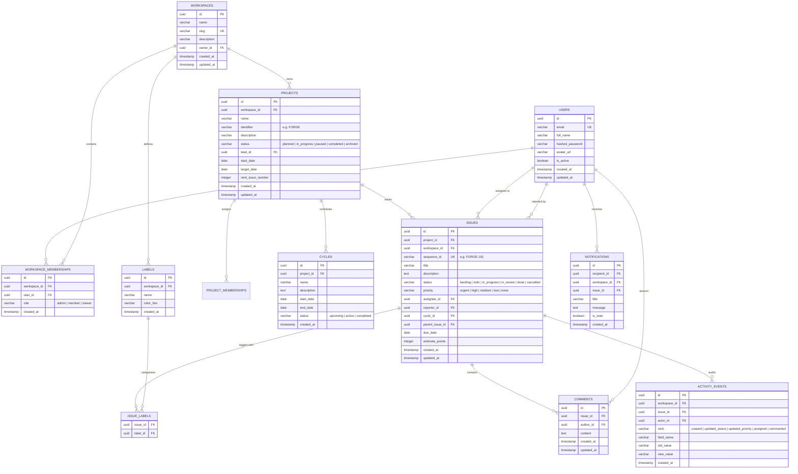

# ForgeFlow — Database Design & Entity Relationship Specification

## 1. Relational Schema Diagram (Mermaid)

---

## 2. Table Specifications & Indexes

### 2.1 Workspace Isolation Rules
1. All queries for project, issue, comment, and activity data MUST filter by `workspace_id`.
2. A foreign key index is placed on `workspace_id` for every tenant-scoped table (`projects`, `issues`, `labels`, `activity_events`, `notifications`).
3. Unique constraints:
   - `workspaces(slug)`: Enforces friendly URLs (`/workspaces/acme-corp/...`).
   - `workspace_memberships(workspace_id, user_id)`: Prevents duplicate membership records.
   - `issues(project_id, sequence_id)`: Guarantees unique human identifiers within a project.
   - `labels(workspace_id, name)`: Prevents duplicate label names within a workspace.

### 2.2 Key Indexes
- `idx_issues_workspace_status`: `(workspace_id, status)` for fast Kanban column grouping.
- `idx_issues_project_status`: `(project_id, status)` for project board rendering.
- `idx_issues_assignee`: `(assignee_id)` for "My Issues" instant filtering.
- `idx_activity_issue`: `(issue_id, created_at DESC)` for chronological audit logs.
- `idx_notifications_unread`: `(recipient_id, is_read)` for notification badge counts.
